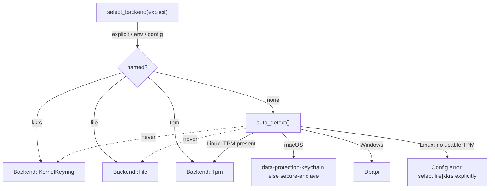
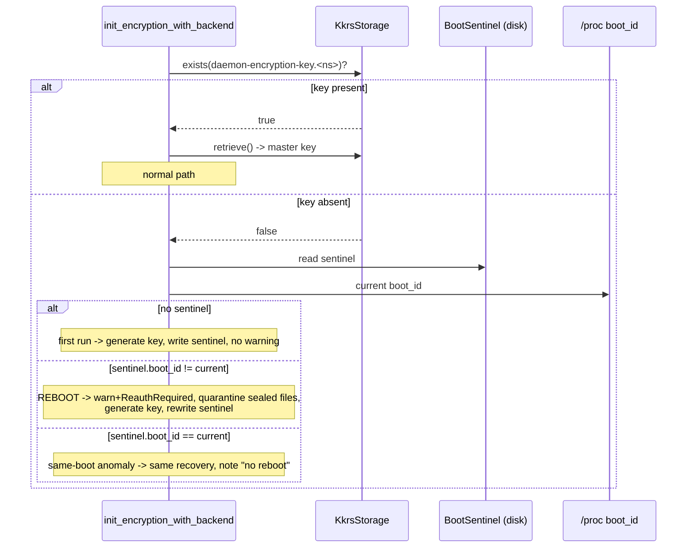

# Design: KKRS Encryption-Key Backend

**Status:** accepted
**Feature:** `kkrs-encryption-backend`
**Requirements:** see `requirements.md` in this directory.

## Overview

This feature adds a Linux `SecureStorage` backend, `KkrsStorage`, that keeps the
AES-256 master key in the **kernel user keyring** via the pure-Rust
[`linux-keyutils`](https://crates.io/crates/linux-keyutils) crate (no
`libkeyutils` C dependency). It follows the existing backend pattern
(`storage/file.rs`, `storage/macos.rs`): a struct implementing the
`SecureStorage` trait, gated with `#[cfg(all(target_os = "linux", feature = "kkrs"))]`,
wired into the `Backend` enum and `create_storage()` factory. No shipped build
enables the `kkrs` feature (requirements, Requirement 6).

The master key in the user keyring is cleared on reboot. To make that visible
rather than surprising, a small **boot sentinel** on disk records the boot
identity present when the key was created. At startup, when the KKRS key is
absent, the sentinel tells the key-init path whether this is a first run, a
reboot, or a same-boot anomaly — and the reboot/anomaly cases trigger a clear
re-auth signal and move the now-undecryptable sealed files aside into a pruned
quarantine directory instead of a silent key regeneration.

KKRS is **opt-in only**: `auto_detect()` never returns it. As of the
`tpm-encryption-backend` feature, Linux auto-detect returns `tpm` when a usable
TPM is present and otherwise a configuration error requiring an explicit backend
choice — it never silently falls back to `file` or `kkrs`. Both `file` and
`kkrs` are reachable only by explicit selection (see Key Design Decision 2 and
the precedence table below).

## Key Design Decisions

1. **User keyring, not session keyring.** `KeyRingIdentifier::User` scopes the
   key to the UID and keeps it alive across the daemon process exiting and
   across SSH reconnects — exactly what a restartable service needs — while
   still being wiped on reboot. The session keyring would die with the login
   session (too short-lived for a `systemd --user` / launchd service). *(The
   prototype's `design.md` prose said "session keyring" but its code used the
   user keyring; we standardize on the user keyring, which matches the
   requirement.)*

2. **Opt-in, never auto-detected.** Because a reboot silently invalidates every
   cached credential, selecting KKRS is a deliberate choice. `auto_detect()` on
   Linux returns `Tpm` when a usable TPM is present and otherwise **returns a
   configuration error** requiring an explicit `file`/`kkrs` choice — it never
   returns KKRS, and (as of the `tpm-encryption-backend` feature) never silently
   returns `File` either. `file` and `kkrs` are explicit opt-in only because
   each has a materially different guarantee and a silent fallback would be a
   silent posture change. This is the single most important behavioral guardrail
   in the feature.

3. **Boot identity via `boot_id`, not uptime/mtime arithmetic.**
   `/proc/sys/kernel/random/boot_id` is a random UUID regenerated on every boot.
   Comparing the stored value to the current one is an exact, unambiguous
   "did we reboot?" test with **no clock dependency**. The alternative the
   requirement raised — comparing a file's mtime to boot time derived from
   `/proc/uptime` (`boot_time = now − uptime`) or `/proc/stat` `btime` — works
   but is fragile: NTP steps, suspend/resume, and clock skew all perturb the
   arithmetic, and mtime can be touched by unrelated writes. We therefore make
   `boot_id` primary and keep `btime` only as a fallback for the rare kernel
   without `boot_id`. See *Reboot Classification* below.

4. **Quarantine stale sealed files on reboot recovery, reusing the shared
   helper.** Once the master key is regenerated, the old sealed files are dead
   weight that would otherwise surface as "decrypt failed"/"corrupt" on the next
   read. Moving them out of the scanned credential trees makes `credential_status`
   report a clean "no session", which is the honest state. They are **moved to a
   quarantine directory, not deleted**: after a key loss the blobs are
   permanently undecryptable by the daemon, but a non-destructive recovery leaves
   them intact for possible off-line inspection or manual recovery rather than
   discarding a user's only copy. Retention is bounded — the newest `N = 3`
   quarantine generations are kept and older ones pruned — so the backups cannot
   grow without limit; pruning our own generations is the only delete recovery
   performs. KKRS reuses the shared `quarantine_sealed_credentials_after_reseal()`
   helper (also used by the TPM backend) rather than building its own, so the two
   recovery paths share one audited enumeration. Quarantine deliberately also
   captures imported long-term IAM key files (see the caveat in
   `requirements.md`) — consistent with the "wiped on reboot" posture.

5. **Reboot logic lives in the key-init path, not the trait.** `SecureStorage`
   stays a narrow key/value contract (`store`/`retrieve`/`delete`/`exists`/
   `backend_name`). The sentinel + classification + recovery is KKRS-specific
   orchestration invoked from `init_encryption_with_backend` only when
   `backend == Backend::KernelKeyring`. This keeps every other backend byte-for-
   byte unchanged.

6. **Boot-identity source is injectable for tests.** Classification is a pure
   function of `(key_present, sentinel, current_boot_id)`. Reading `/proc` is
   isolated behind a single function so tests pass synthetic boot ids and
   exercise every branch of the truth table without rebooting.

## Architecture

### Backend selection (with forward-looking TPM 2.0)



### KKRS key-init flow (reboot detection)



## Components and Interfaces

### 1. `KkrsStorage` (`src/storage/linux_kkrs.rs`, `#[cfg(all(target_os = "linux", feature = "kkrs"))]`)

Implements the existing trait:

```rust
pub trait SecureStorage: Send + Sync {
    fn store(&self, key_id: &str, data: &[u8]) -> Result<()>;
    fn retrieve(&self, key_id: &str) -> Result<Vec<u8>>;
    fn delete(&self, key_id: &str) -> Result<()>;
    fn exists(&self, key_id: &str) -> bool;
    fn backend_name(&self) -> &'static str;
}
```

Using `linux_keyutils::{KeyRing, KeyRingIdentifier}`:

- `store`: `KeyRing::from_special_id(KeyRingIdentifier::User, false)` then
  `add_key(description, data)`. `add_key` on an existing description updates the
  payload, so `store` is idempotent. `description = format!("{SERVICE_NAME}:{key_id}")`
  reusing `storage::SERVICE_NAME` (`com.amazon.aws.credsd`) — the shared
  credential-store key, same as the macOS Keychain service name. (The launchd
  label and systemd unit are separate, per-platform identifiers and intentionally
  differ from this.)
- `retrieve`: `keyring.search(&description)` → `key.read_to_vec()`; map both
  failures to `DaemonError::Storage`.
- `delete`: `search`; if found, `key.invalidate()` (immediate removal); a
  not-found result is `Ok(())` (idempotent, per 2.6).
- `exists`: `keyring.search(&description).is_ok()`.
- `backend_name`: `"kkrs"`.

### 2. `BootSentinel` (in `linux_kkrs.rs` or a small sibling)

```rust
#[derive(serde::Serialize, serde::Deserialize)]
struct BootSentinel {
    boot_id: Option<String>,   // /proc/sys/kernel/random/boot_id, when available
    boot_time: Option<i64>,    // /proc/stat btime fallback (epoch seconds)
    created_at: String,        // rfc3339, for operator diagnostics
}
```

- Path: `config::platform::data_dir().join("kkrs.sentinel")`, written `0600`
  under the `0700` data dir (same convention as `EncryptionService::seal_to_file`).
- Serialized with `serde_json` (matches the rest of the codebase).
- `fn current_boot_id() -> Option<String>` reads
  `/proc/sys/kernel/random/boot_id` (trimmed). `fn current_boot_time() -> Option<i64>`
  parses the `btime` line of `/proc/stat`. Both are the only `/proc` touch
  points and are the seam tests stub.

### 3. Reboot classification (pure function)

```rust
enum KkrsKeyState {
    Present,          // key in keyring; load it
    FirstRun,         // key absent, no sentinel; generate + write sentinel
    Rebooted,         // key absent, sentinel boot identity differs
    VanishedSameBoot, // key absent, sentinel boot identity matches
}

fn classify(
    key_present: bool,
    sentinel: Option<&BootSentinel>,
    current_boot_id: Option<&str>,
    current_boot_time: Option<i64>,
) -> KkrsKeyState
```

Rules:
- `key_present` → `Present`.
- else `sentinel` is `None` → `FirstRun`.
- else compare boot identity:
  - If both sides have a `boot_id`: differ → `Rebooted`, equal → `VanishedSameBoot`.
  - Fallback (no `boot_id` on one side): if the sentinel's `boot_time` is
    earlier than the current `boot_time` → `Rebooted`; equal → `VanishedSameBoot`;
    if neither identity source is available → treat as `Rebooted` (fail safe:
    prefer a re-auth prompt over silent data loss).

### 4. Integration in `init_encryption_with_backend` (`crates/credsd-core/src/encryption.rs`)

Today (simplified):

```rust
let slot = key_slot(home); // daemon-encryption-key.<ns>
let key_bytes = if store.exists(&slot) {
    store.retrieve(&slot)?
} else {
    let key = generate_key();
    store.store(&slot, &key)?;
    key
};
```

New: when `backend == Backend::KernelKeyring`, route the "absent" branch through
classification:

- `Present` → `retrieve` (unchanged).
- `FirstRun` → generate, `store`, write sentinel. Info log.
- `Rebooted` → `warn!` that a reboot cleared cached credentials; quarantine
  sealed files (below); generate, `store`, rewrite sentinel. The daemon continues
  with an empty cache — subsequent credential fetches naturally hit the re-auth
  path (`DaemonError::ReauthRequired`) rather than decrypt errors.
- `VanishedSameBoot` → same as `Rebooted`, but the log notes "no reboot detected
  (keyring cleared mid-session)".

All other backends keep the original two-branch logic untouched (Req 4).

### 5. Sealed-file quarantine (reboot recovery)

Reboot recovery reuses the shared `quarantine_sealed_credentials_after_reseal()`
helper (also used by the TPM backend), rather than building a new one. The daemon
seals **every** provider type — SSO, IAM, RolesAnywhere, aws-web-identity (OAuth +
DPoP) and aws-login (Sign-In + DPoP), JWT — symmetrically under the caller's uid-partitioned tree, and the one
daemon-wide master key protects every caller's blobs, so its loss orphans all of
them. The shared helper scans **both** credential trees the master key protects:

- the daemon tree `<data_dir>/callers/*/credentials/*/*.enc`, and
- the legacy standalone tree `<data_dir>/credentials/*/*.enc`.

It **moves** each orphaned `*.enc` artifact (`sso_token.enc`, `iam_user.enc`,
`oauth_token.enc`, `dpop_key.enc`, `jwt.enc`) out of those trees into a
timestamped quarantine generation under `<data_dir>/quarantine/<UTC-timestamp>/`,
mirroring the file's original relative path and preserving its `0600` mode; the
generation dir and `quarantine/` are `0700`. `quarantine/` lives outside the
scanned credential trees so `credential_status` reads a clean "no session". The
newest `N = 3` generations are kept and older ones pruned.

Missing any of these would leave undecryptable blobs that resurface as "decrypt
failed" — the exact outcome recovery exists to prevent.

It is best-effort (log-and-continue on per-file errors, and cross-filesystem
moves fall back to copy-then-remove) and is invoked only from the `Rebooted` /
`VanishedSameBoot` branches. It does **not** touch config or the sentinel.

### 6. `Backend` enum wiring (`src/storage/mod.rs`)

- New variant `Backend::KernelKeyring`.
- `parse("kkrs") => Some(KernelKeyring)`; `as_str() => "kkrs"`.
- The variant, `parse` and `as_str` are compiled unconditionally, so a build
  without the feature can name the backend in its "not compiled" error.
- `Backend::COMPILED` includes `KernelKeyring` only on Linux with the `kkrs`
  feature; `is_available()` is `COMPILED.contains(&KernelKeyring)`. Because the
  cross-backend key check iterates `COMPILED`, a build without the feature never
  probes the keyring.
- `create_storage(KernelKeyring)` → Linux with the feature:
  `Ok(Box::new(KkrsStorage::new()))`; Linux without it: a "not compiled into
  this build; rebuild with `--features kkrs`" configuration error; non-Linux:
  `Err(DaemonError::config("kkrs backend requires Linux"))`.
- `select_backend` treats `kkrs` like `tpm`: on Linux without the feature it
  reports "not compiled" rather than "not available".
- `auto_detect()` unchanged (never yields `KernelKeyring`).
- The "unknown storage backend" error lists `Backend::COMPILED`, so it names
  `kkrs` exactly when the build has it.
- `linux-keyutils` is an optional dependency enabled by the feature, and the
  reboot-recovery branch in `encryption.rs` is compiled only with it.

## Data Models

### Keyring key layout

| Field | Value |
|---|---|
| Keyring | `KeyRingIdentifier::User` (per-UID) |
| Key type | `"user"` |
| Description | `com.amazon.aws.credsd:<key_id>` |
| Payload | raw master-key bytes (32) |
| Permissions | possessor + owner (keyutils default) |
| Lifetime | until reboot |

### Boot sentinel (`<data_dir>/kkrs.sentinel`, `0600`)

| Field | Value |
|---|---|
| `boot_id` | `/proc/sys/kernel/random/boot_id`, trimmed (primary identity) |
| `boot_time` | `/proc/stat` `btime` epoch seconds (fallback identity) |
| `created_at` | RFC-3339 timestamp of key creation (diagnostics only) |

### Backend selection precedence (Linux)

| Order | Backend | When | Never |
|---|---|---|---|
| 1 | TPM 2.0 | usable device present, or explicit | — |
| — | (error) | no usable TPM and no explicit backend | — |
| — | File | explicit selection only | auto-detect fallback |
| — | KKRS | explicit selection only | auto-detect fallback |

`file` and `kkrs` are explicit opt-in only — never an auto-detect fallback —
because each has a materially different guarantee (`file`: cross-user protection
but no device binding; `kkrs`: kernel-memory key wiped on reboot). See the
`tpm-encryption-backend` spec for the authoritative precedence definition.

## Correctness Properties

**Property 1 — store/retrieve round-trip.** *For any* `key_id` (non-empty) and
key bytes (non-empty), `store` then `retrieve` with the same `key_id` returns
byte-identical bytes. **Validates: 2.1, 2.2.**

**Property 2 — missing key errors.** *For any* `key_id` never stored, `retrieve`
returns `DaemonError::Storage` and `exists` returns `false`. **Validates: 2.5, 2.7.**

**Property 3 — delete is idempotent.** Deleting an absent key returns `Ok`;
deleting a present key makes `exists` return `false`. **Validates: 2.6.**

**Property 4 — KKRS is never auto-detected.** *For any* platform/hardware state,
`auto_detect()` never returns `KernelKeyring`. **Validates: 1.3.**

**Property 5 — description format.** *For any* non-empty `key_id`, the keyring
description equals `com.amazon.aws.credsd:{key_id}` exactly. **Validates: 2.1.**

**Property 6 — reboot classification truth table.** *For any*
`(key_present, sentinel, current_boot_id, current_boot_time)`, `classify`
returns: `Present` iff `key_present`; else `FirstRun` iff `sentinel.is_none()`;
else `Rebooted` iff the boot identity differs (or is indeterminate); else
`VanishedSameBoot`. **Validates: 3.2, 3.5, 3.6, 3.7.**

**Property 7 — first run is silent.** WHEN classification is `FirstRun`, no
warning is emitted and a sentinel is written. **Validates: 3.5.**

**Property 8 — reboot signals, does not silently rekey.** WHEN classification is
`Rebooted` or `VanishedSameBoot`, a warning is emitted, sealed files under both
`<data_dir>/callers/*/credentials/*/` (every provisioned uid) and the legacy
`<data_dir>/credentials/*/` tree are moved into a `<data_dir>/quarantine/<ts>/`
generation (not deleted; newest `N = 3` kept), and the sentinel is rewritten with
the current boot identity. **Validates: 3.3, 3.4.**

**Property 9 — non-KKRS isolation.** *For any* backend other than
`KernelKeyring`, no sentinel is read or written and the original key-init path
runs unchanged. **Validates: 3.8, 4.1, 4.2.**

**Property 10 — backend-name consistency.** *For any* `KkrsStorage`,
`backend_name()` returns `"kkrs"` and `is_file_on_linux` is false (no perms-only
warning). **Validates: 1.6, 4.3.**

## Error Handling

- Keyring access / `add_key` / `search` / read failures →
  `DaemonError::Storage("...: {os_error}")` with operation context.
- Missing key on `retrieve` → `DaemonError::Storage` (Property 2); callers add
  credential-specific guidance as they do today.
- Reboot / same-boot recovery surfaces to the user as `DaemonError::ReauthRequired`
  semantics on the next credential fetch (the cache is empty), plus a one-time
  `warn!` at startup. The daemon does **not** fail to start on a detected reboot.
- Sentinel read/parse failure is treated as "no sentinel" (→ `FirstRun`) and
  logged at debug; a corrupt sentinel must never wedge startup.
- `kkrs` selected on non-Linux → `DaemonError::Config` (Req 1.4).

## Testing Strategy

### Property-based (`proptest`, ≥100 iterations, platform-independent)

- **Property 4** — assert `auto_detect()` result is never `KernelKeyring` across
  a matrix of simulated platform/availability inputs.
- **Property 5** — random non-empty `key_id` → description equals the expected
  format.
- **Property 6** — exhaustively drive `classify` over generated
  `(key_present, sentinel?, boot_id pair, boot_time pair)` and assert the truth
  table. This is the core logic and needs no keyring.

### Unit

- `Backend::parse` / `as_str` round-trip includes `"kkrs"` in every build;
  `is_available` is true only on Linux with the `kkrs` feature.
- Without the feature, selecting or constructing `kkrs` fails with the "not
  compiled" error, and the unknown-backend list names exactly `COMPILED`.
- `create_storage(KernelKeyring)` errors on non-Linux with a Linux-mentioning
  message.
- Sentinel serialize/deserialize round-trip; corrupt bytes → treated as absent.
- Classification branches individually (Present / FirstRun / Rebooted /
  VanishedSameBoot), including the `btime` fallback and the "no identity source"
  fail-safe-to-`Rebooted` case — all via injected boot identities (no reboot).

### Linux integration (`#[cfg(all(target_os = "linux", feature = "kkrs"))]`)

CI runs these with `cargo test -p credsd-core --features kkrs` on the Linux
runner rows, and lints with `--features credsd-core/kkrs`.


- Real user-keyring round-trip: `store` → `exists` → `retrieve` → `delete`,
  asserting byte-identity and post-delete absence. Runnable on a normal Linux
  session (including this AL2023 host) and Linux CI; skipped gracefully if no
  session/user keyring is available (e.g. minimal containers) rather than
  failing.
- Reboot recovery end-to-end: seed a sentinel with a synthetic differing
  `boot_id`, place dummy sealed files in both the daemon
  (`callers/<uid>/credentials/<name>/sso_token.enc`) and legacy
  (`credentials/<name>/oauth_token.enc`) trees, run the key-init path, and assert
  the files were moved into a `quarantine/<ts>/` generation (mirrored path,
  originals gone, a fresh key stored). Reboots are *simulated* via the injected
  boot-identity seam; tests never require an actual reboot.
