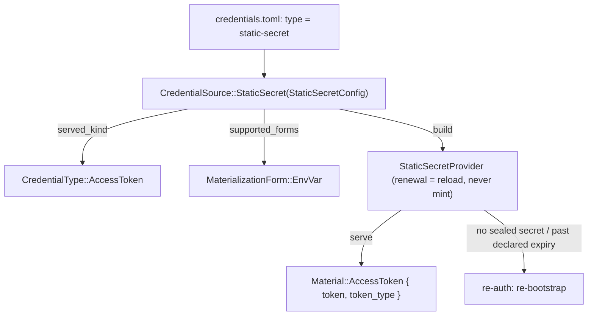
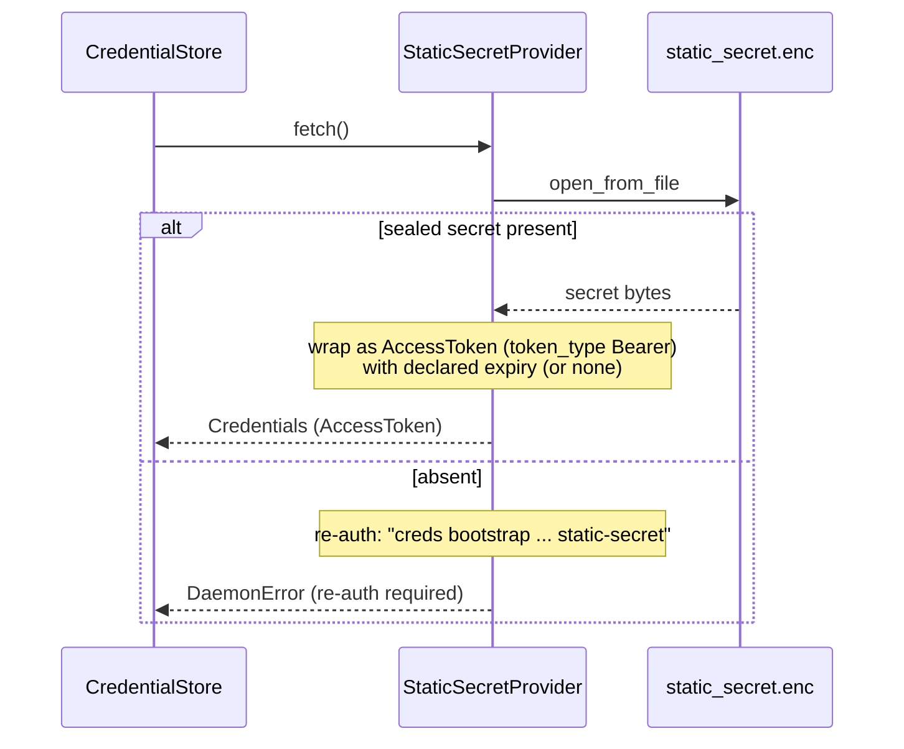

# Design: Static-Secret Credentials

**Status:** accepted — `env_var` is the credential-level address declaration of
`credential-projection`; returns to `complete` once 3.3's credential and environment levels are
verified against `creds get`'s shell formats
**Feature:** `static-secret-credentials`
**Requirements:** see `requirements.md` in this directory.

## Overview

`static-secret` adds a `CredentialSource` and a `CredentialProvider` for a secret
the user already holds. The provider is modeled on `providers/jwt.rs` — seal on
bootstrap, serve verbatim, reload-only renewal — with one difference: a JWT carries a
parseable `exp` the provider reads, whereas a static secret is opaque, so its
expiry is an optional value the user declares in config rather than something
credsd derives.

The material surface is already present. `Material::AccessToken { token,
token_type }` (the singular-token material) is what OAuth/JWT sources serve, and
the `MaterializationForm::EnvVar` projection is the path bearer-token sources
already take. `static-secret` reuses both — no new material or projection type.
The new code is a config struct, a source variant, a small provider, a bootstrap
handler, and a CLI subcommand. One shared field changes: `CredentialResult`'s (and
`Credentials`') `expires_at` becomes nullable so a never-expiring secret is
represented as `null` rather than a magic date (see Key Design Decision 3).

## Key Design Decisions

1. **Model on `jwt`, not `aws-iam-user`.** Despite the user-facing resemblance to
   IAM-user ("paste a secret, we seal it"), the runtime behavior is the `jwt`
   family's: no exchange, no unattended re-minting, served verbatim as an
   `AccessToken`. `jwt` is the structural template; IAM-user informs only the
   "sealed pasted secret, never in `credentials.toml`" storage convention, which
   both families share anyway.

2. **`renewer()` returns the provider, and renewal is a load.** Renewable in the
   seam's sense only: serving the sealed secret needs no human, so a cache miss can
   be satisfied by reading `static_secret.enc`. What renewal cannot do is produce a
   *different* secret — there is no issuer to ask — so a missing secret, or one past
   its declared expiry, is an error naming the re-seal rather than a
   `ReauthRequired`, which would advertise an interactive flow that does not exist.
   Exactly how `jwt` behaves.

   Returning `None` instead would make the source unservable: the store's only path
   to sealed material is through the renewer, so a cache miss would skip the load,
   find nothing, and report the credential as unknown — surfacing as "env not
   found". The background loop still leaves this source alone, because a credential
   with no declared expiry never nears one.

3. **Expiry is declared, lives in config, and is nullable on the wire.** An opaque
   secret has no intrinsic lifetime. The user may record an absolute `expires_at`;
   when absent the credential never expires and its `credential/get` response
   carries `expires_at: null`. This makes `expires_at` an `Option<DateTime<Utc>>`
   end-to-end — on the internal `Credentials` model and on the wire
   `CredentialResult` — where `None`/`null` means "never expires" and
   `is_expired()` reads `None` as never. That is a breaking wire change to a field
   shared by every credential kind; it requires the amendment to
   `credential-retrieval-api` Requirement 4 (an absolute expiry **or** explicit
   null; relative lifetimes still prohibited) and, per that spec's pre-launch
   policy, is accepted without a `PROTOCOL_VERSION` bump for want of deployed
   consumers. The expiry is not secret, so it stays in `credentials.toml` and the
   `.enc` file holds only the secret — the existing "config in TOML, secret in
   `.enc`" split.

4. **`token_type` is always `"Bearer"`, not configurable.** Reusing
   `Material::AccessToken` requires a `token_type`, and the daemon already
   hardcodes it to `"Bearer"` at the single serving site (`server/dispatch.rs`)
   because `CredentialData` keeps only the token. `static-secret` inherits that
   unchanged: no config field, no model change, no shared-path edit. Request
   binding — header name, scheme, query placement — is the consumer's contract; a
   consumer needing a non-Bearer scheme applies it itself. If a future consumer
   ever needs credsd to state a different scheme, making `token_type` configurable
   (an optional field on `CredentialData::AccessToken`, defaulting to `Bearer`) is
   an additive change that can be taken up then.

5. **Secret captured from file or stdin, never a CLI argument.** A secret on the
   command line leaks into shell history and process listings. Bootstrap reads it
   from `--secret-file` or stdin, like `jwt`'s `--token-file`.

## Architecture

### Source resolution



### Serving flow



## Components and Interfaces

### 1. `StaticSecretConfig` (`src/config/mod.rs`, new)

```rust
#[derive(Debug, Clone, Serialize, Deserialize)]
pub struct StaticSecretConfig {
    /// The credential-level address declaration for this credential's `env-var` projection.
    /// Absent means no declaration at this level: an env or an invocation may still declare
    /// one, and failing that the resolver derives it from the credential's name. Same field
    /// and same meaning on `JwtConfig`.
    #[serde(default, skip_serializing_if = "Option::is_none")]
    pub env_var: Option<String>,
    /// Optional absolute expiry (RFC 3339). Absent means the secret never expires.
    #[serde(default, skip_serializing_if = "Option::is_none")]
    pub expires_at: Option<chrono::DateTime<chrono::Utc>>,
    /// Where the secret came from, recorded for re-seal diagnostics only. Never read at
    /// runtime (mirrors `JwtConfig::token_file`).
    #[serde(default, skip_serializing_if = "Option::is_none")]
    pub secret_source: Option<String>,
    /// Who this credential is for. See `SsoConfig::identity_type`.
    #[serde(default, skip_serializing_if = "is_default_identity")]
    pub identity_type: IdentityType,
}
```

### 2. `CredentialSource` wiring (`src/config/credentials.rs`)

- New variant `StaticSecret(StaticSecretConfig)`, tag `"static-secret"` (kebab-case).
- `source_type()` → `CredentialSourceType::StaticSecret`.
- `served_kind()` → `CredentialType::AccessToken`.
- `identity_type()` → the config's `identity_type`.

### 3. `CredentialSourceType::StaticSecret` (`src/rpc/methods.rs`)

- New discriminant `StaticSecret` (snake_case `static_secret`) so the source has a
  serialize path and does not report as `Unsupported`.
- `supported_forms()` → `&[MaterializationForm::EnvVar]` (joins the `Jwt | Oauth |
  JwtBearer` arm).
- Human-facing name for the `creds list` MODE column.

### 4. `StaticSecretProvider` (`src/providers/static_secret.rs`, new)

Structurally a clone of `providers/jwt.rs` without `exp` parsing.

```rust
const SECRET_FILE: &str = "static_secret.enc";

pub fn persist_secret(
    encryption: &EncryptionService,
    data_dir: &Path,
    secret: &Zeroizing<String>,
) -> Result<()>;   // seals `secret` to <data_dir>/static_secret.enc (0600)

pub struct StaticSecretProvider { /* name, config, encryption, data_dir */ }
```

- On fetch: `open_from_file(SECRET_FILE)` → `Credentials::access_token(secret,
  expires_at)`, where `expires_at` is `config.expires_at` (an
  `Option<DateTime<Utc>>`): `Some` for a declared expiry, `None` for none — which
  serves as `expires_at: null` and is never expired (Key Design Decision 3;
  `access_token`'s `expires_at` parameter and `Credentials::expires_at` become
  `Option`, and `is_expired()` reads `None` as never). `Credentials::access_token`
  takes **no** `token_type` — the daemon's `CredentialData::AccessToken` stores
  only the token, and the wire projection stamps `token_type = "Bearer"` (see Key
  Design Decision 4).
- Absent file → `DaemonError::provider` naming the re-bootstrap command
  (`reseal_command`, placeholders for `<env>`/`<path>` as `jwt` does, since a
  recorded `secret_source` is caller-controlled and must not be interpolated into a
  daemon log line).
- `CredentialProvider::renewer()` → `Some(self)`; `mode_name()` → `"static-secret"`.
- Implements `Renewer`, where `renew()` reloads the sealed secret, checks the declared
  expiry if one is recorded, and mints nothing.

### 5. Provider construction (`src/credential_store.rs`)

New match arm alongside `CredentialSource::Jwt`:

```rust
CredentialSource::StaticSecret(cfg) => {
    let provider = StaticSecretProvider::new(
        credential_name.clone(),
        cfg.clone(),
        encryption.clone(),
        caller_root(uid).join("credentials").join(&credential_name),
    );
    providers.insert(credential_name, Box::new(provider));
}
```

### 6. Bootstrap (`src/server/bootstrap.rs`, `src/rpc/methods.rs`)

- New `ProviderParams::StaticSecret { secret, env_var, expires_at,
  secret_source }` (secret carried inline over the UDS bootstrap call, like the
  `jwt` token — `ProviderParams`/`Material` redaction already covers it).
- `bootstrap_static_secret`: seal the secret via `persist_secret`, then write the
  `StaticSecretConfig` entry (secret first, then config, matching `jwt`'s order so a
  failure never leaves a config entry with no sealed secret).
- Interactive setup (`credsd bootstrap`) for a `static-secret` credential named
  explicitly is a no-op beyond sealing — there is nothing to mint.

### 7. CLI (`src/main.rs`, credsd client)

New `BootstrapProvider::StaticSecret`:

```
creds bootstrap --env <env> [--credential <name>] static-secret \
    [--secret-file <path> | (stdin)] \
    [--env-var <VAR>] [--expires-at <rfc3339>]
```

The secret is read from `--secret-file` or stdin (Req 2.1); `secret_source` records
the path (or `"stdin"`) for diagnostics.

## Data Models

### Sealed secret (`<data_dir>/static_secret.enc`, `0600`)

| Field | Value |
|---|---|
| Payload | the raw secret bytes (opaque, uninterpreted) |
| Lifetime | until re-bootstrapped |

### Config entry (`credentials.toml`)

```toml
[work]
type = "static-secret"
env_var = "OPENAI_API_KEY"     # optional; omitted, the resolver derives it from the name
expires_at = "2026-12-31T00:00:00Z"  # optional; default never expires
```

### `credential/get` response (`CredentialResult`)

No new result or material type — the existing `CredentialResult` carries it. With
a declared expiry:

```json
{
  "credential": "work",
  "material": { "type": "access_token", "token": "<the secret>", "token_type": "Bearer" },
  "expires_at": "2026-12-31T00:00:00Z",
  "provenance": "cached_shared"
}
```

With no declared expiry, `expires_at` is `null` (the field stays present):

```json
{
  "credential": "work",
  "material": { "type": "access_token", "token": "<the secret>", "token_type": "Bearer" },
  "expires_at": null,
  "provenance": "cached_shared"
}
```

`provenance` is always `cached_shared`: the secret is served from the shared
sealed file, never minted per request. `credential/get_batch` uses the same
`CredentialResult` as its element type, so a batch that names a `static-secret`
carries exactly this element.

## Correctness Properties

**Property 1 — round-trip serve.** *For any* non-empty secret, after
`persist_secret` the provider serves `Material::AccessToken` whose `token` equals
that secret. **Validates: 2.2, 2.3, 3.1.**

**Property 2 — token_type is always Bearer.** *For any* `static-secret` credential,
the served `Material::AccessToken.token_type` is `"Bearer"`. **Validates: 3.2.**

**Property 3 — the variable is resolved, not owned here.** The projection variable is
whatever a `credential-projection` resolver resolves for the credential:
`config.env_var` when set and no nearer level declares one, else the nearest declaration, else the
derived name.
This source contributes a declaration and no default. **Validates: 3.3.**

**Property 4 — absent secret is re-auth, not error.** WHEN no sealed secret exists,
status is `NoSession` and a fetch returns a re-auth error naming the bootstrap
command. **Validates: 3.4.**

**Property 5 — reloaded, never re-minted.** Renewal opens `static_secret.enc` and
returns its contents; no code path contacts an issuer, and a credential with no
declared expiry is never picked up by the background refresh loop.
**Validates: 4.1, 4.1a.**

**Property 6 — expiry semantics.** WHEN no `expires_at` is set, status is `Active`
while a secret is present, the credential is never expired, and the
`credential/get` response carries `expires_at: null`; WHEN set, status is
`Active`/`Expiring`/`Expired` per the shared status logic against that value and
the response carries that absolute expiry. **Validates: 4.2, 5.2, 5.3.**

**Property 7 — projection is EnvVar only.** `supported_forms()` for
`StaticSecret` is exactly `[EnvVar]`. **Validates: 1.4.**

**Property 8b — response shape.** *For any* served `static-secret`, the
`CredentialResult` has `material.type == "access_token"`, `provenance ==
cached_shared`, and `expires_at` either an RFC 3339 string or `null`.
**Validates: 3.5.**

**Property 8 — source serialize path.** A `StaticSecret` source round-trips through
`credentials.toml` and reports discriminant `static_secret` in a manifest (never
`Unsupported`). **Validates: 1.1, 1.3, 6.3.**

## Error Handling

- Missing sealed secret on fetch → `DaemonError::provider` naming the re-bootstrap
  command (no secret interpolation into logs; `<env>`/`<path>` stay placeholders).
- Decrypt/IO failure on the sealed file → propagates unchanged, as `jwt` does (a
  keystore-key change is the actionable cause, and the message names re-bootstrap).
- Empty secret at bootstrap → rejected before sealing.
- `env_var`/`expires_at` are validated at bootstrap; a malformed `expires_at` is a
  config error surfaced then, not at serve time.

## Testing Strategy

### Property-based (`proptest`, platform-independent)

- **Property 1** — random non-empty secret → served `token` equals it.
- **Property 3** — random present/absent `env_var` → projection variable is the
  declaration when set, else the name derived from the credential. Two credentials with
  names differing outside the folded characters, neither declaring one, resolve to two
  variables and the selection runs.

### Unit

- `CredentialSource` parse/serialize round-trip for `type = "static-secret"`,
  including each optional field and their defaults.
- `served_kind` = `AccessToken`; `source_type` = `StaticSecret`;
  `supported_forms` = `[EnvVar]`.
- Provider: seal → serve round-trip; absent file → error naming the bootstrap
  command; renewal reloads rather than mints.
- Expiry: no `expires_at` → `Active` and never expired; past `expires_at` →
  `Expired`; near → `Expiring` (via the shared status helper).
- Bootstrap orders seal-before-config; a seal failure leaves no config entry.

## File changes

| File | Change |
|---|---|
| `src/config/mod.rs` | New `StaticSecretConfig`. |
| `src/config/credentials.rs` | `CredentialSource::StaticSecret`; `source_type`/`served_kind`/`identity_type` arms. |
| `src/rpc/methods.rs` | `CredentialSourceType::StaticSecret`; `supported_forms`/name arms; `ProviderParams::StaticSecret`. Reuses `Material::AccessToken` unchanged. **`CredentialResult.expires_at` → `Option<DateTime<Utc>>`** (nullable; `null` = never). |
| `src/credentials.rs` | **`Credentials::expires_at` → `Option<DateTime<Utc>>`**; `access_token` takes `Option`; `is_expired()` reads `None` as never. Affects every provider that stamps an expiry (all pass `Some`). |
| `src/credential_status.rs` | Treat `None` expiry as `Active`/never-expired. |
| `src/providers/static_secret.rs` | New provider (`persist_secret`, `reseal_command`, serve via a reload-only renewer). |
| `src/providers/mod.rs` | `pub mod static_secret;`. |
| `src/credential_store.rs` | Build `StaticSecretProvider` for the new source. |
| `src/server/bootstrap.rs` | `bootstrap_static_secret`: seal then write config. |
| `src/main.rs` (credsd client) | `static-secret` bootstrap subcommand (file/stdin secret). |
| `docs/specs/credential-retrieval-api/` | Req 4 amended (absolute **or** null expiry); design notes the nullable field as a pre-launch breaking wire change (no `PROTOCOL_VERSION` bump). |

## Spec coherence

Requirement 4.1 states renewability as *reload, never re-mint* rather than as
`renewer() == None`. An earlier reading of "re-auth-only" as "no renewer at all"
does not survive contact with the provider seam: the credential store reaches sealed
material only through a provider's renewer, so a source without one can never be
served — a cache miss skips the load, finds nothing, and reports the credential as
unknown. Every shipped provider therefore returns a renewer, `jwt` included, and
`jwt` is this source's structural template. The intent behind "re-auth-only" is
preserved and now stated where it belongs: nothing contacts an issuer, and a new
secret requires a human. Requirement 4.1a carries the background-loop half of that
intent explicitly, since a credential with no declared expiry never nears one.


This builds on `credential-retrieval-api`: it reuses `Material::AccessToken`, the
per-entry `env_var` manifest field (that spec's Req 6 AC 3), and the `EnvVar`
projection. It introduces no new wire type.

It **does** change one shared contract: `CredentialResult.expires_at` becomes
nullable so a never-expiring secret can be represented honestly. This contradicted
`credential-retrieval-api` Requirement 4 as originally written ("Every
material-bearing response MUST carry an absolute expiry"), so that requirement is
amended here — with explicit approval — to permit an absolute expiry **or** an
explicit null, while keeping the relative-lifetime prohibition its intent was
about. The amendment and the nullable-field note live in that spec; this is a
pre-launch breaking wire change with no `PROTOCOL_VERSION` bump, consistent with
that spec's existing pre-launch policy. No existing source's *behavior* changes —
every other source continues to stamp an absolute expiry (`Some`).
