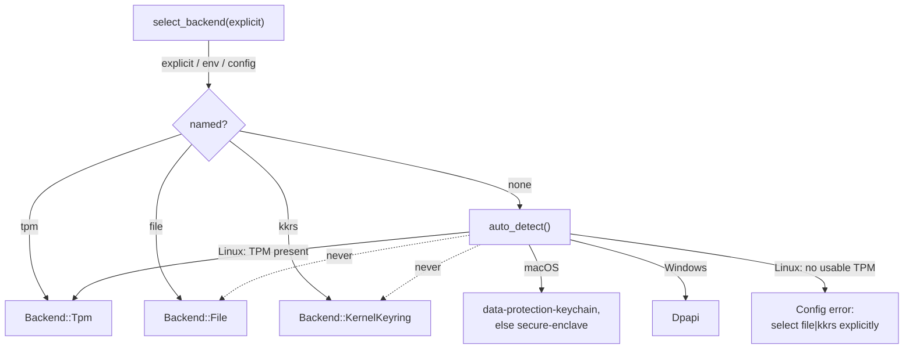
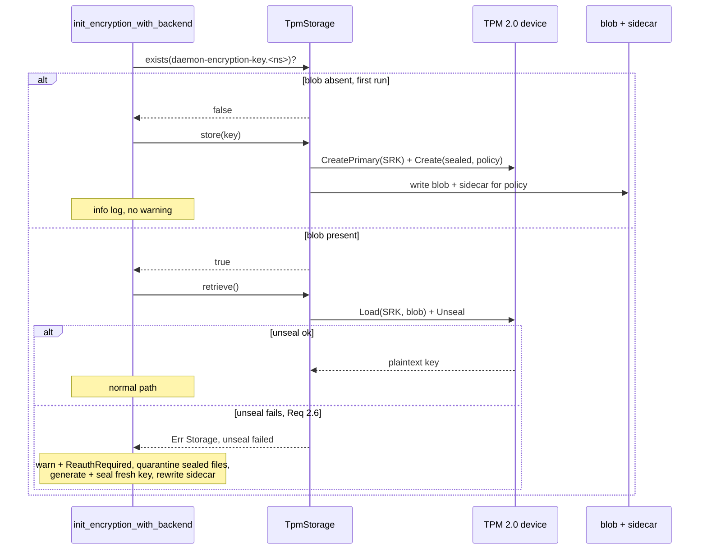

# Design: TPM 2.0 Encryption-Key Backend

**Status:** accepted
**Feature:** `tpm-encryption-backend`
**Requirements:** see `requirements.md` in this directory.

## Overview

This feature implements `TpmStorage`, a Linux `SecureStorage` backend that
**seals** the AES-256 master key to a TPM 2.0 device. The sealed blob is written
to disk; the plaintext key exists only inside the TPM and, transiently, in
process memory after a successful unseal.

It follows the existing backend pattern (`storage/file.rs`, `storage/macos.rs`):
a struct implementing the `SecureStorage` trait, platform-gated with
`#[cfg(target_os = "linux")]`, wired into the `Backend` enum and
`create_storage()`. The `Backend::Tpm` variant and the `/dev/tpmrm0` probe
already exist; today `create_storage(Tpm)` returns "not yet implemented" — this
feature replaces that with a real implementation.

The `SecureStorage` contract is unchanged: `store(key_id, plaintext)` seals and
persists; `retrieve(key_id)` reads the blob and unseals to plaintext — exactly
the shape the Keychain/DPAPI backends already present to callers. The sealing is
an implementation detail behind the trait.

## Key Design Decisions

1. **Seal-on-store, unseal-on-retrieve behind the existing trait.** No trait
   change. `store` receives the plaintext master key (as every backend does) and
   seals it; `retrieve` returns the unsealed plaintext. Callers
   (`init_encryption_with_backend`) are unaware sealing happened.

2. **On-disk sealed blob under the SRK — not TPM NVRAM.** Sealing under a primary
   key (SRK) derived from the owner-hierarchy seed lets us keep the persisted
   state as an ordinary `0600` file and reload it after reboot, while the key
   material stays TPM-bound. This avoids scarce NVRAM and matches the "blob on
   disk, key in hardware" model that survives reboot (Req 2.3) — the primary
   posture difference from `kkrs`.

3. **The only policy is machine-bound (empty policy); PCR 7 is deferred.** See
   *PCR 7 vs. machine-bound* below. Machine binding optimizes for operational
   stability (no silent unseal breakage on routine updates). The policy is not
   selectable, so nothing outside key initialization can change what the key is
   bound to.

4. **Unseal failure is treated like the KKRS "reboot surprise".** A present blob
   that will not unseal is not a silent re-key. It surfaces as a clear
   re-auth signal, moves the stale sealed credential files aside into a pruned
   quarantine directory, then re-seals a fresh key — mirroring the KKRS recovery
   path so the two Linux backends behave consistently on "the protected key is
   gone".

5. **`exists` checks blob presence only; unsealability is separate.** `exists`
   answering "is there a blob" (not "can I unseal it") keeps the trait method
   cheap and side-effect-free. The init path distinguishes present-and-unsealable
   from absent via `retrieve`'s error (Req 2.6), which is where recovery lives.

6. **TPM stack: `tss-esapi` (wraps the system `tpm2-tss` C libraries) — approved.**
   Unlike the KKRS backend, which chose the pure-Rust `linux-keyutils` to avoid a
   C dependency, no mature pure-Rust TPM 2.0 stack exists. `tss-esapi` is the
   de-facto standard ESAPI binding (maintained by the Parsec project; ~3.4M
   downloads, ~869k in 90 days — orders of magnitude ahead of any alternative)
   and links the same `libtss2-*` libraries already present on this class of host
   (the `device` TCTI is what `tpm2-tools` uses). *Alternatives considered:* the
   pure-Rust `tpm-rs` (`tpm2` crate) would remove the C dependency, but it is
   pre-alpha — self-described "very unstable", `0.1.0` a 2026 restart with ~50
   downloads/90d and only "core types and traits", no usable seal/unseal API —
   so it is tracked, not adopted. **Licensing (verified):** `tss-esapi` and
   `tss-esapi-sys` are **Apache-2.0**; the linked system `tpm2-tss` C libraries
   are **BSD-2-Clause** — both permissive and compatible with this repo's
   Apache-2.0. The dependency and its added complexity are **approved**;
   the integration is the minimum needed to seal a key to hardware (no gratuitous
   abstraction beyond the single `TpmSeam` seam), which satisfies the minimalism
   ladder. The backend isolates all `tss-esapi` calls behind that seam so the
   rest of the codebase stays TPM-stack-agnostic and a future pure-Rust swap
   stays contained.

7. **TPM operations are injectable for tests.** The seam that talks to the TPM
   is a single trait so the reboot/recovery orchestration and policy sidecar
   logic can be unit-tested without hardware; real-TPM round-trips run as
   `#[cfg(target_os = "linux")]` integration tests, skipped gracefully when no
   device is present (same pattern as the KKRS integration tests).

## PCR 7 vs. machine-bound — the sealing-policy decision

Both policies seal under the SRK; they differ only in the **policy** attached to
the sealed object, i.e. what the TPM checks before it will unseal. `machine` is
implemented; `pcr7` is the candidate further policy, analyzed here so that adding
it is a policy decision rather than a fresh design.

### Option A — `machine`: empty policy

Unseal succeeds whenever the **same TPM** (same owner-hierarchy seed) is present.

**Breaks unsealing:**
- TPM is cleared (`tpm2_clear`, firmware "clear TPM", or ownership reset).
- TPM hardware is replaced, or the disk/blob is moved to another machine
  (**intended** — this is the anti-exfiltration property).
- Owner hierarchy auth is set to an unknown value out of band.

**Does NOT break unsealing:**
- Reboots, kernel updates, bootloader updates, firmware updates, Secure Boot
  policy changes, dbx revocation updates.

**Security:** Protects against offline disk theft and cross-machine copy, and
keeps no cleartext key on disk. Does **not** detect boot-chain tampering — an
attacker who boots a malicious kernel/initramfs on the *same* machine can still
unseal, because the policy checks nothing about boot state.

### Option B — `pcr7`: sealed to Secure Boot policy

Unseal succeeds only while **PCR 7** matches its value at seal time. PCR 7 holds
UEFI **Secure Boot policy** state: whether Secure Boot is enabled, plus the
PK / KEK / db / dbx key databases as applied by firmware.

**Breaks unsealing (in addition to every Option A condition):**
- Secure Boot is toggled on/off.
- Any change to PK / KEK / db / **dbx**. Note **dbx (revocation) updates are
  routine** — pushed by `fwupd`/LVFS and OS security updates to revoke
  vulnerable bootloaders — and change PCR 7 **without user action**. This is the
  single most likely cause of a surprise unseal failure.
- Firmware updates that re-apply or reorder the Secure Boot databases.
- Booting a differently-signed bootloader (e.g. switching distros / shim keys).

**Does NOT break unsealing:**
- Ordinary kernel updates. The kernel/initramfs are measured into PCR 4/8/9, not
  PCR 7 — which is precisely why PCR 7 is the *least fragile* boot-state PCR to
  bind to. Binding to PCR 0–9 broadly would break on every kernel update; PCR 7
  moves only when the Secure Boot *policy* changes.

**Security:** Adds tamper-evidence — disabling Secure Boot to boot a malicious
kernel that extracts the key causes unseal to fail. It is still coarse: it does
not measure the specific kernel/initramfs (that is PCR 4/8/9 / IMA, out of
scope).

### Decision

Seal under **`machine`** only; the policy is not selectable. Rationale: credsd is
a userspace credential daemon where a silently-bricked key is a serious
operational failure — the entire KKRS spec exists to eliminate exactly that
"surprise". `pcr7`'s breaking conditions (dbx/firmware updates) occur **without
user action**. Machine binding already delivers the primary TPM value (no
cleartext on disk, anti-exfiltration).

`pcr7` is deferred, not rejected. Two conditions gate it:

- **Validation.** The PCR policy-session path must run on a real TPM (NitroTPM)
  before it is offered; a simulator cannot reproduce PCR 7 contents (see
  *Development with swtpm*).
- **Explicit selection, with re-wrap.** A policy read from the daemon's
  environment applies only when a key is next sealed, so setting it against an
  existing key changes nothing while appearing to. As with backend selection,
  the policy is chosen explicitly at key initialization, and changing it for an
  existing key is an explicit operation that unseals under the recorded policy
  and re-seals under the new one. The environment is never a selection path;
  `CREDSD_TPM_POLICY` is refused rather than ignored, so a setting carried over
  from a drop-in cannot pass for a binding the key does not have.

The sidecar's `policy` field is what keeps the door open: a blob records the
policy it was sealed under, so `pcr7` can be added without changing the sidecar
format, and a blob sealed under a policy the build does not support is refused
instead of unsealed as machine-bound.

## Architecture

### Backend selection (Linux, post-precedence-change)



`file` and `kkrs` are reachable **only** via explicit selection — never as an
auto-detect fallback (see the precedence table in `requirements.md` and the
matching note in the KKRS spec).

### Seal / unseal flow



## Components and Interfaces

### 1. `TpmStorage` (`src/storage/tpm.rs`, new, `#[cfg(target_os = "linux")]`)

Implements the existing trait:

```rust
pub trait SecureStorage: Send + Sync {
    fn store(&self, key_id: &str, data: &[u8]) -> Result<()>;
    fn retrieve(&self, key_id: &str) -> Result<Vec<u8>>;
    fn delete(&self, key_id: &str) -> Result<()>;
    fn exists(&self, key_id: &str) -> bool;
    fn backend_name(&self) -> &'static str;
}
```

- `store`: open a TPM context (device TCTI on `/dev/tpmrm0`), create/derive the
  SRK under the owner hierarchy, seal `data` as a keyedhash object under the SRK
  with an empty policy, then write `<data_dir>/tpm/<key_id>.sealed` (`0600`) and
  `<data_dir>/tpm/<key_id>.meta` (`0600`, policy identifier).
  Idempotent: an existing blob is overwritten.
- `retrieve`: read the blob + sidecar, refuse a sidecar naming any policy but
  `machine` (Req 3.7), reload the SRK, `Load` the object, and `Unseal`. Map a
  missing blob to `DaemonError::Storage` with an "absent" marker; map an unseal
  rejection to `DaemonError::Storage` with an "unsealable" marker so the init
  path can tell them apart (Req 2.5 vs 2.6).
- `delete`: remove blob + sidecar; absent → `Ok(())` (idempotent).
- `exists`: blob file present on disk (no TPM call).
- `backend_name`: `"tpm"`.

Plaintext key bytes read out of `Unseal` are held in a `Zeroize`-on-drop buffer
before being handed to `EncryptionService` (Req 5.1).

### 2. TPM seam (testability)

A narrow internal trait wraps the `tss-esapi` calls actually used
(`seal(plaintext)`, `unseal(blob)`).
`TpmStorage` depends on this trait; the real impl is `tss-esapi`, and tests
inject a fake to exercise store/retrieve/delete/exists and the sidecar logic
without hardware. Real-hardware behavior is covered by the integration test.

### 3. Sealing-policy sidecar

```rust
#[derive(serde::Serialize, serde::Deserialize)]
struct SealMeta {
    policy: String,            // "machine"
    created_at: String,        // rfc3339, diagnostics only
}
```

`<data_dir>/tpm/<key_id>.meta`, `0600`, `serde_json`. No secret material
(Req 3.1, 5.2). Records the policy the blob was sealed under. The field is a
string rather than an enum so a sidecar naming a policy this build does not know
still parses and is refused by name (Req 3.7), instead of failing as malformed.
Unknown fields are ignored, so a policy that needs more state (a PCR selection)
can add it.

### 4. Integration in `init_encryption_with_backend` (`src/encryption.rs`)

Today (`encryption.rs:203`):

```rust
let slot = key_slot(home); // daemon-encryption-key.<ns>
let key_bytes = if store.exists(&slot) {
    store.retrieve(&slot)?
} else {
    let key = generate_key()?;
    store.store(&slot, &key)?;
    key
};
```

For `Backend::Tpm`, the "present but `retrieve` failed to unseal" case routes
through recovery instead of propagating a raw error:

- **blob absent** → generate, `store` (seal), write sidecar. Info log. (Req 3.5)
- **blob present, unseal ok** → use plaintext. Info log. (unchanged path)
- **blob present, unseal fails** → `warn!` naming the likely cause; quarantine
  sealed files (shared helper with KKRS); generate, `store` (re-seal), rewrite
  sidecar; continue with an empty cache so the next credential fetch hits the
  re-auth path (`DaemonError::ReauthRequired`) rather than a decrypt error.
  (Req 3.3, 3.4)

All non-TPM backends keep the original two-branch logic untouched (Req 4).
The `is_file_on_linux` perms-only warning still fires only for `file` (Req 4.3).

### 5. Sealed-file quarantine (shared with KKRS)

The reboot-recovery quarantine helper specified in the KKRS design is reused
verbatim by the TPM unseal-failure branch. It scans **both** credential trees the
master key protects — the daemon tree `<data_dir>/callers/*/credentials/*/*.enc`
and the legacy standalone tree `<data_dir>/credentials/*/*.enc` — and **moves**
each orphaned `*.enc` (not deletes it) into a timestamped generation under
`<data_dir>/quarantine/<UTC-timestamp>/`, mirroring the original relative path
and preserving `0600` (generation dir and `quarantine/` are `0700`). The newest
`N = 3` generations are kept and older ones pruned. Best-effort
(log-and-continue; cross-filesystem moves fall back to copy-then-remove). It does
not touch config, the sealed blob, or the sidecar. Quarantine-rather-than-delete
is deliberate: after a TPM reset the old blobs are permanently undecryptable, so
a non-destructive recovery preserves them for possible off-line inspection while
keeping `credential_status` clean, with bounded retention so backups cannot grow
without limit.

### 6. `Backend` enum + selection wiring (`src/storage/mod.rs`)

- `Backend::Tpm` already exists; `parse("tpm")`/`as_str()` already return it.
- `is_available()` for `Tpm` stays `probe_tpm()` (device-node presence) but
  `create_storage(Tpm)` additionally verifies the TPM answers the required
  commands, returning `DaemonError::Config`/`Storage` (never a fallback) on
  failure (Req 1.4).
- `create_storage(Backend::Tpm)` on Linux → `Ok(Box::new(TpmStorage::new()?))`, after refusing a set `CREDSD_TPM_POLICY` (Req 3.6);
  non-Linux → `Err(DaemonError::config("tpm backend requires Linux"))` (Req 1.5).
- **`auto_detect()` changes (precedence):** on Linux, return `Backend::Tpm` when
  `Backend::Tpm.is_available()`, else return a `DaemonError::Config` instructing
  explicit selection of `file` or `kkrs`. This requires `auto_detect()` /
  `select_backend()` to return `Result<Backend>` on the no-TPM Linux path rather
  than defaulting to `File`. **This changes current shipped behavior** (Linux
  previously defaulted to `file`) and supersedes KKRS spec Req 1.3/1.5 — see the
  precedence note added to that spec.

## Data Models

### Sealed key layout

| Field | Value |
|---|---|
| Parent | SRK (owner-hierarchy primary, `tss-esapi` default template) |
| Sealed object | keyedhash, payload = raw master-key bytes (32) |
| Policy | empty (`machine`) |
| Blob path | `<data_dir>/tpm/<key_id>.sealed`, `0600` |
| Sidecar path | `<data_dir>/tpm/<key_id>.meta`, `0600` |
| Access control | `/dev/tpmrm0` device-node perms (`tss` group) — OS-mediated, not TPM |
| Lifetime | until TPM clear / blob deletion |

### Backend selection precedence (Linux)

| Order | Backend | When | Never |
|---|---|---|---|
| 1 | `tpm` | usable TPM present, or explicit | — |
| — | (error) | no usable TPM and no explicit backend | — |
| — | `file` | explicit only | auto-detect fallback |
| — | `kkrs` | explicit only | auto-detect fallback |

## Correctness Properties

**Property 1 — seal/unseal round-trip.** *For any* `key_id` and key bytes, with
the sealing policy satisfied, `store` then `retrieve` returns byte-identical
bytes. **Validates: 2.2.** *(fake TPM in unit tests; real TPM in integration.)*

**Property 2 — absent vs. unsealable are distinguishable.** `retrieve` on an
absent blob and `retrieve` on a present-but-unsealable blob return
distinguishable errors. **Validates: 2.5, 2.6.**

**Property 3 — no cleartext on disk.** *For any* `store`, the only bytes written
are the sealed blob and the (non-secret) sidecar; the plaintext key never
appears on disk. **Validates: 2.4, 5.1.**

**Property 4 — delete is idempotent.** Deleting absent → `Ok`; deleting present
removes blob + sidecar and makes `exists` false. **Validates: 2.7, 2.8.**

**Property 5 — auto-detect never silently downgrades.** *For any* Linux state,
`auto_detect()` returns `Tpm` iff a usable TPM is present, else an error — never
`File` or `KernelKeyring`. **Validates: 1.3.**

**Property 6 — explicit TPM never falls back.** WHEN `tpm` is selected but the
device is unusable, `create_storage` returns an error and no other backend is
constructed. **Validates: 1.4.**

**Property 7 — unseal failure signals, does not silently re-key.** WHEN a present
blob fails to unseal, a warning is emitted, sealed files under both
`<data_dir>/callers/*/credentials/*/` and the legacy `<data_dir>/credentials/*/`
tree are moved into a `<data_dir>/quarantine/<ts>/` generation (not deleted;
newest `N = 3` kept), a fresh key is sealed, and the sidecar is rewritten.
**Validates: 3.3, 3.4.**

**Property 8 — first run is silent.** WHEN no blob exists, no warning is emitted
and a blob + sidecar are written. **Validates: 3.5.**

**Property 9 — sidecar records policy, holds no secret.** *For any* `store`, the
sidecar records the policy and contains no key bytes. **Validates: 3.1, 3.2, 5.2.**

**Property 11 — the policy is never chosen implicitly.** WHEN `CREDSD_TPM_POLICY`
is set, constructing the backend fails; WHEN a sidecar names a policy other than
`machine`, retrieve fails and the blob still counts as present.
**Validates: 3.6, 3.7.**

**Property 10 — non-TPM isolation.** *For any* backend other than `Tpm`, no
blob/sidecar is read or written and the original key-init path runs unchanged;
the perms-only warning fires for `file` and not for `tpm`.
**Validates: 4.1, 4.2, 4.3.**

## Error Handling

- Device open / SRK derive / seal / load / unseal failures →
  `DaemonError::Storage("...: {tpm_error}")` with operation context, never a
  fallback to another backend.
- Missing blob on `retrieve` → `DaemonError::Storage` tagged "absent" (Property 2).
- Unsealable blob → `DaemonError::Storage` tagged "unsealable"; surfaces to the
  user as `ReauthRequired` on the next fetch plus a one-time startup `warn!`. The
  daemon does **not** fail to start on an unseal failure (it re-seals a fresh key).
- Corrupt/absent sidecar with a present blob → treat as unsealable (fail safe to
  recovery) rather than guessing a policy; logged at debug.
- `tpm` on non-Linux → `DaemonError::Config`. `tpm` on Linux with no usable
  device → `DaemonError::Config`/`Storage` (no fallback).

## Testing Strategy

### Unit (platform-independent, fake TPM seam)

- Store/retrieve/delete/exists round-trips against the fake TPM, asserting
  byte-identity and post-delete absence.
- Absent vs. unsealable error tagging (fake returns each) → Property 2.
- Sidecar serialize/deserialize round-trip; corrupt/absent sidecar → treated as
  unsealable; sidecar never contains key bytes.
- `auto_detect()` matrix: TPM-present → `Tpm`; no-TPM → error (never `File`/
  `KernelKeyring`) → Property 5. Explicit-`tpm`-unusable → error → Property 6.
- Recovery branch: seed a present-but-unsealable blob + dummy sealed files in
  both the daemon (`callers/<uid>/credentials/<name>/sso_token.enc`) and legacy
  (`credentials/<name>/*.enc`) trees; run key-init; assert the files were moved
  into a `quarantine/<ts>/` generation (mirrored path, originals gone, newest
  `N = 3` retained), a fresh blob written, warning emitted → Property 7.
- `Backend::parse`/`as_str` round-trip for `"tpm"`; perms-only warning fires for
  `file`, not `tpm` → Property 10.

### Policy selection (unit, fake TPM)

- A set `CREDSD_TPM_POLICY` fails backend construction; a sidecar naming `pcr7`
  is refused and `exists` stays true; a sidecar carrying an extra `pcr_selection`
  field still unseals → Property 11.

### Linux integration (`#[cfg(target_os = "linux")]`, real or software TPM)

- Real seal → unseal → delete round-trip on `/dev/tpmrm0`, skipped gracefully
  when no device is present (mirrors the KKRS integration-test skip).
- `machine` policy: seal, then unseal succeeds after a simulated process restart.

## Development with swtpm

This feature targets **NitroTPM** on Linux EC2 instances. Development hosts
without a TPM (e.g. a plain EC2 instance — no `/dev/tpm*`, no ACPI TPM tables)
can use the `swtpm` software emulator, **but only where there is high confidence
the emulated path matches NitroTPM.** Both implement TPM 2.0, so the criteria
for "acceptable to develop on swtpm" are:

1. **Same interface.** Drive swtpm through the same resource-managed path the
   code uses in production: the kernel `/dev/tpmrm0` node backed by swtpm via
   `tpm_vtpm_proxy` (`swtpm chardev --vtpm-proxy`). The daemon opens only that
   node; the swtpm socket TCTI is honored only by the crate's own unit tests,
   because a socket TCTI is unauthenticated and whoever binds the port would be
   the TPM.
2. **Same command set.** Every command the backend issues (CreatePrimary/SRK
   derive, Create/Load of a keyedhash sealed object, Unseal) is standard TPM 2.0
   and present in both — high confidence for the **`machine`** policy and for the
   seal/unseal mechanics generally.
3. **PCR-7 semantics are NOT portable.** PCR 7 reflects the UEFI Secure Boot
   policy of the *actual* boot environment. swtpm + OVMF will not reproduce
   NitroTPM's PCR-7 contents, so `pcr7` behavior (and its break conditions), if
   it is offered, MUST be validated on a real NitroTPM instance before it is trusted — swtpm can
   only confirm the *code path* (policy session builds, unseal fails on a changed
   PCR), not the *real-world values*.

**Bottom line:** swtpm is acceptable for developing and unit/integration-testing
the `machine` policy and the seal/unseal/recovery mechanics; a `pcr7` policy's
real behavior requires a NitroTPM instance (launch with `--tpm-support v2.0` on a
UEFI AMI) to confirm before it is offered.
